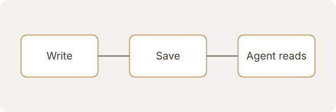

# Links and images

An [inline link](https://example.com), a [link with a title](https://example.com "Example site"), and an autolink: <https://example.com>.

A bare URL stays text: https://example.com.

A [reference-style link][ref] (saved as an inline link if you edit this line).

[ref]: https://example.com

## Images

From the assets folder (SVG):

A PNG in the same folder, with a title:

From a subfolder:

Mid-sentence: text before  text after.

A linked image: 

A missing image shows a placeholder: 

Type `/image` to insert one, or paste or drop an image file here.
