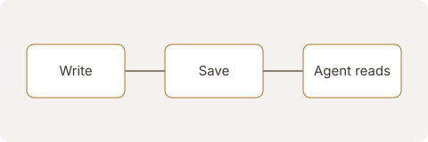

# Everything in one note

A paragraph with **bold**, *italic*, ~~strike~~, `code`, a [link](https://example.com) and a footnote[^a].

## Lists

- Bullet
  1. Numbered inside
     - [ ] Task inside

## Quote

> Quoted text with `code`.

## Code

```ts
const answer: number = 42;
```

## Table

| Left | Center | Right |
| :--- | :---: | ---: |
| a | b | c |

## Image



## HTML

Press <kbd>Esc</kbd>.

---

[^a]: Footnotes live at the end.
